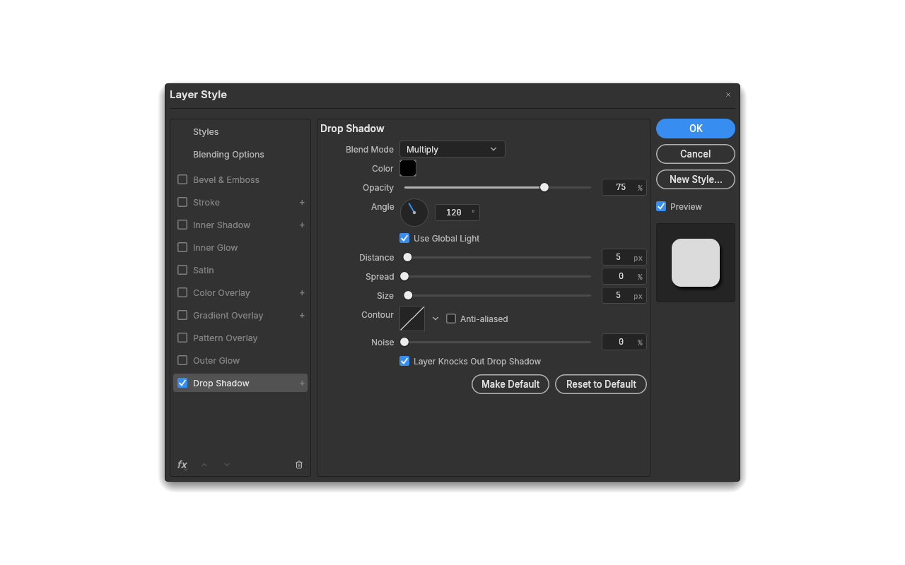
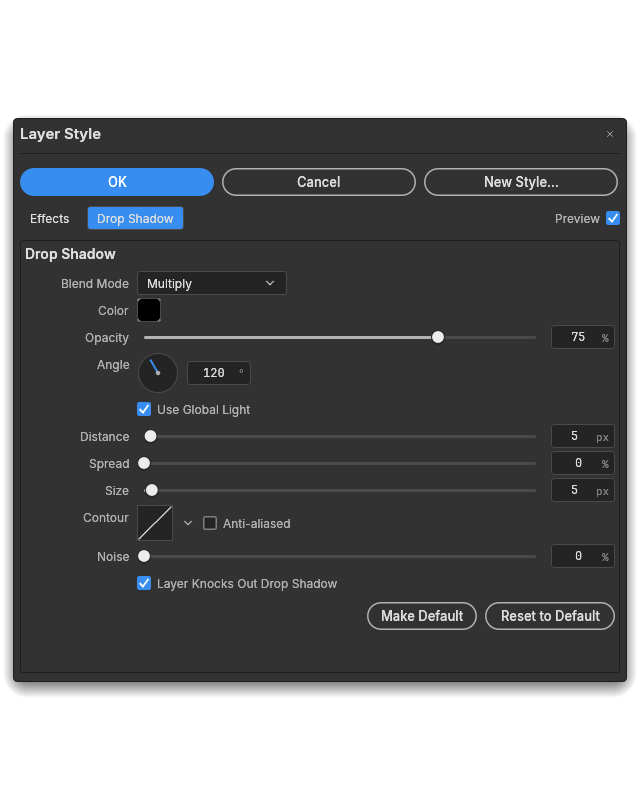
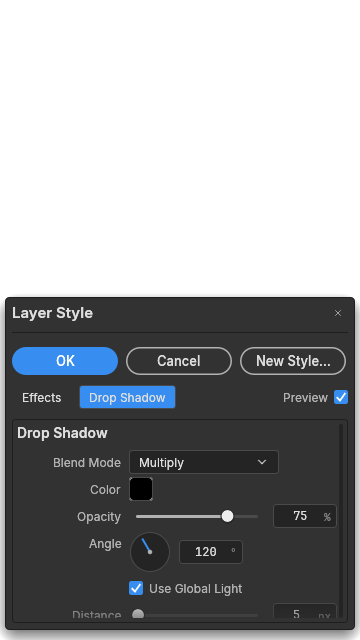
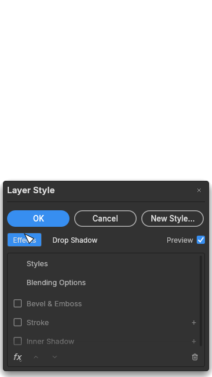

# 🎨 PhotoCraft for Android — Smooth Pen Edition ✒️⚡

### A desktop-class image editor on your Android **tablet** 📲, now with lower pen lag and a Layer Style dialog that fits every screen.


> [!IMPORTANT]
> 🙏 **This is not my original work.** This repository is a modified copy of
> **[morte2437/photocraft-android](https://github.com/morte2437/photocraft-android)**, the
> unofficial Android port of PhotoCraft made by **[@morte2437](https://github.com/morte2437)**.
> All the Android porting work (pen input, touch gestures, Shortcut Pad, file pickers, the phone
> layout and much more) is **theirs** ❤️. PhotoCraft itself is made by the **ArtCraft team and
> the PhotoCraft contributors** ([storytold/photocraft](https://github.com/storytold/photocraft)).
> This fork only adds the fixes listed below. Please ⭐ and support the original projects!

---

## 🙌 Credits

| Who | What | Link |
|---|---|---|
| 👑 **morte2437** | Created the Android port this fork is built on | [morte2437/photocraft-android](https://github.com/morte2437/photocraft-android) |
| 🎨 **ArtCraft team & PhotoCraft contributors** | Created PhotoCraft, the editor itself | [storytold/photocraft](https://github.com/storytold/photocraft) |
| 🛠️ **This fork** | Lower pen lag, Layer Style fixes, crash hardening (see below) | you are here |

- 📥 The first commit in this repo is morte2437's code **exactly as they published it**
  (branch `android-port`, commit `e4258e9`, version 0.23.1-1), credited to them as its author.
- 🔧 The commits after it are this fork's changes, so you can see every line that changed.
- 📄 Their original README is kept, unchanged, in [`UPSTREAM-README.md`](UPSTREAM-README.md):
  read it for the full feature tour, how-tos and screenshots 📸.
- ⚖️ License: the same as the original, **MIT or Apache-2.0** ([`LICENSE-MIT`](LICENSE-MIT),
  [`LICENSE-APACHE`](LICENSE-APACHE), [`NOTICE`](NOTICE), [`ATTRIBUTION.md`](ATTRIBUTION.md)).
- 🚫 Not made, supported or endorsed by morte2437, the PhotoCraft developers or ArtCraft.
  Please report problems with **this** build here, not to them.

---

## ⬇️ Download

| 📦 File | 📍 Where |
|---|---|
| 🤖 **APK** (`photocraft-0.23.1-4-arm64-v8a.apk`) | 👉 [**Releases**](https://github.com/sankalp-v1/PhotoCraft--Android/releases) |
| 🗜️ Same APK, zipped | [`release/PhotoCraft-0.23.1-4-arm64-v8a.apk.zip`](release/PhotoCraft-0.23.1-4-arm64-v8a.apk.zip) (unzip it to get the APK) |
| 🔐 Checksums | [`release/SHA256SUMS.txt`](release/SHA256SUMS.txt) |
| 📝 Full changelog | [`release/CHANGES-0.23.1-4.md`](release/CHANGES-0.23.1-4.md) |

> [!NOTE]
> 🗜️ The APK is 112 MB and GitHub doesn't allow files over 100 MB in a repository, so the copy
> in `release/` is zipped (47 MB). The APK attached to the Release is the same file.

### 📲 Installing

1. ⚠️ **Coming from the official port (morte2437's APK)?** It's signed with a different key, so
   Android won't install this over it. Export your settings first (Edit › Preferences ›
   Export Settings…), **uninstall** the old app, install this one, then import your settings.
2. 📥 Download the APK, open it and allow "install unknown apps" when Android asks.
3. 🔄 Updates: the in-app updater (Help › Check for Updates…) follows **this** repository's
   releases, so future builds of this fork install with one tap.

---

## ✨ What this fork changes

### ✒️ 1. Pen lag (original issue [#11](https://github.com/morte2437/photocraft-android/issues/11))

🔎 **Why it lagged:** in #11 the tester measured each frame taking **34–35 ms** to reach the
screen on a 90 Hz Galaxy Tab, **23 ms** of it just waiting in the display's queue. Every pen
sample (240 a second) asked for a new frame, so that queue was always full and the ink on screen
was 2–3 screen refreshes old.

| ⚡ Fix | 💬 What it does |
|---|---|
| 🚦 **No more frame queue** | The newest frame goes straight to the screen at each refresh (Vulkan mailbox / OpenGL ES swap interval 0). No tearing: Android composites the screen. |
| ⏱️ **Smart frame pacing** (`src/pace.rs`) | Twice per screen refresh while you draw (120–240 fps), the screen's own rate for animations, nothing when idle. Less heat 🔥, so tablets don't slow themselves down mid-stroke. |
| 🖊️ **Pen samples drawn immediately** (`src/pen_path.rs`) | Each pen sample is drawn as soon as Android delivers it, without waiting for the slower copy of the same touch event. It can't go backwards and falls back safely if the two disagree. |
| 🧵 **Pen thread never waits** | Android's input thread no longer blocks on the UI lock while a frame is being prepared. A tiny "frame-waker" thread asks for frames instead. |
| 🚀 **Faster frames** | Drawing thread gets display priority, Android 12+ performance hints keep the CPU fast during strokes, and the screen is asked for its **highest refresh rate**. |
| 🎚️ **New setting** | Window › Touch Input › Touch Input Settings › Pen › **Low latency drawing** (on by default, applies at next start). Turn it off to get the old behaviour back exactly. |

📊 In a timing model of the display (90 Hz, frames taking 2–8 ms), the newest pen sample on
screen goes from **~36 ms old** to **~8–14 ms old**. (It's a model: a real-device measurement is
still to come.)

### 🧩 2. Layer Style fits every screen (original issue [#36](https://github.com/morte2437/photocraft-android/issues/36))

🐛 On a phone the dialog was **676 points wide on a 360-point screen**, hanging off both edges,
so options and OK were out of reach. On a **tablet in split screen** (or a DeX window) it was
also wider than the window.

| 📲 Tablet (full screen): unchanged desktop layout | 🪟 Tablet split screen | 📱 Phone |
|---|---|---|
|  |  |   |

- 🖥️ **Tablets keep the full Photoshop-style layout** (effect list, settings and buttons side by side).
- 📐 When the window is too narrow for that, Layer Style **stacks**: **OK / Cancel / New Style…**
  stay at the top, with **Effects | settings** tabs below. Tapping an effect opens its settings.
- 📏 It never grows bigger than the window.

### 🛡️ 3. No-crash hardening

- 🔁 **No more lost sessions:** Android used to restart the app when you changed font size, language,
  bold text, SIM, colour mode, or plugged in a keyboard or mouse, and a restart ended the editing
  session. Every one of those changes is now handled without a restart.
- 🎮 Marked as a **productivity** app, so device makers' game boosters don't cap its frame rate.
- 🧯 The low-latency ink layer, pointer icons and performance hints can't crash pen input any
  more: if one fails, the stroke carries on.
- 📂 A broken file-picker request is dropped (and answered) instead of blocking every later
  Open / Save As.
- ✋ A pen touching down while your palm rests on the screen starts a clean new stroke.
- 🔄 The in-app updater checks **this** repository, so it never offers APKs signed with another
  key (those fail to install).
- 🧹 Upstream's CI workflows and Dependabot are parked in [`docs/upstream-github/`](docs/upstream-github/)
  so they don't run here.

---

## 🧪 How it was checked

- ✅ **131 / 131** unit tests for the Android app and pen code, including **200 random
  interleavings** of the two pen input streams, lifts, cancels, floods and a display timing model.
- ✅ **New UI tests** render Layer Style at **14 window sizes** (phones upright and on their side,
  tablets landscape and portrait, split screen, DeX windows) and check that it fits and that OK /
  Cancel are in view.
- ✅ **7,457** tests pass in the full interface suite. The few that fail also fail on the **original,
  untouched code** on the build machine (missing CJK/Arabic fonts and low free disk), so none come
  from these changes.
- ✅ No `cargo clippy` warnings for Android in the changed code. Release APK signed (v2),
  16 KB page aligned, and passes Android's pre-release (lint-vital) checks.
- ⚠️ **Honest note:** it hasn't been run on a physical tablet yet (the build machine has no device
  or emulator). If anything feels off, turn off **Low latency drawing** and please open an issue 🙏

---

## 🛠️ Building it yourself

```bash
# Needs: ANDROID_HOME (SDK, platform 35), ANDROID_NDK_HOME (r27+), JDK 17,
#        rustup target add aarch64-linux-android, cargo install cargo-ndk,
#        a storytold/craft-i18n checkout beside this repo (commit in craft-i18n.rev)
RELEASE_BUILD=4 apps/photocraft-android/build.sh
# ➜ target/android/photocraft-0.23.1-4-arm64-v8a.apk
```

More in [`apps/photocraft-android/README.md`](apps/photocraft-android/README.md) and
[`docs/development.md`](docs/development.md).

## 📁 What's where

| 📂 Path | 📄 What |
|---|---|
| `apps/photocraft-android/` | 🤖 The Android app (Rust + the Java Activity) |
| `apps/photocraft-android/src/pace.rs`, `pen_path.rs` | ⚡ Frame pacing and pen path (this fork) |
| `crates/` | 🧠 The PhotoCraft engine and interface |
| `release/` | 📦 Zipped APK, checksums, changelog |
| `UPSTREAM-README.md` | 📄 morte2437's original README |
| `docs/upstream-github/` | 💤 Upstream CI, parked |

---

<sub>💜 Huge thanks to **@morte2437** for the Android port and to the **PhotoCraft / ArtCraft**
team for PhotoCraft. This fork just builds on their work.</sub>
